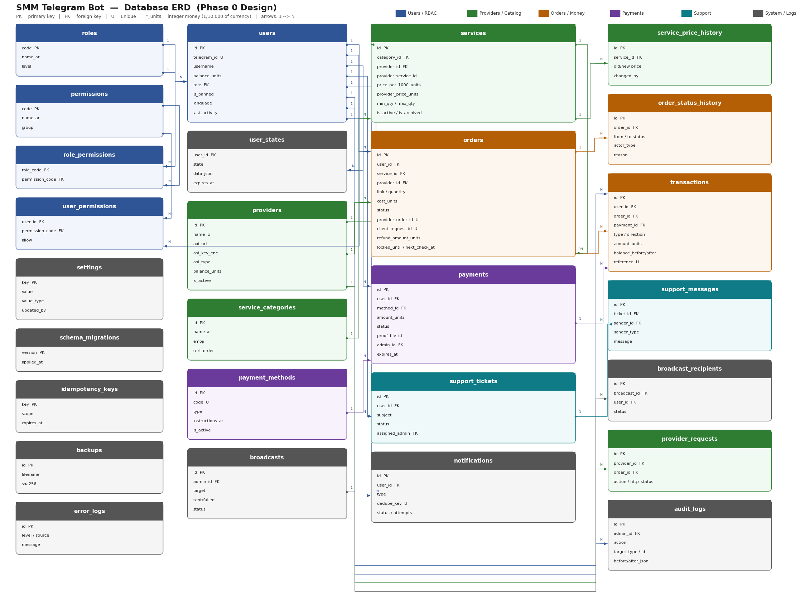

# 📐 المرحلة 0 — تحليل وتصميم نظام SMM Telegram Bot

> **الحالة:** ✅ **معتمدة** — تصميم فقط بلا كود تنفيذي (حسب الاتفاق).
> **الإصدار:** 0.2 — التصميم: 2026-10-01 · **الاعتماد: 2026-10-01**
> **قرار المالك:** «تمت الموافقة على المرحلة 0 — اعتمد توصياتك» ⇐ كل توصيات جدول القرارات **D1–D12** (القسم 13.2) أصبحت **قرارات نافذة ملزِمة** لكل المراحل.

---

## 📑 الفهرس

| # | القسم |
|---|-------|
| 1 | [المعمارية النهائية المقترحة](#1) |
| 2 | [Database ERD نصي](#2) |
| 3 | [الجداول بالتفصيل + العلاقات + الفهارس](#3) |
| 4 | [User Flow](#4) |
| 5 | [Admin Flow](#5) |
| 6 | [Payment Flow](#6) |
| 7 | [Order Lifecycle (State Machine)](#7) |
| 8 | [Provider API Flow](#8) |
| 9 | [Notification Flow](#9) |
| 10 | [الصلاحيات RBAC](#10) |
| 11 | [هيكل الملفات النهائي](#11) |
| 12 | [متطلبات ضرورية لم تُذكر في المواصفات](#12) |
| 13 | [المخاطر + جدول القرارات المطلوب حسمها](#13) |
| 14 | [خطة المراحل ومعيار الاكتمال (DoD)](#14) |
| 15 | [معايير الكود والتعليقات العربية](#15) |

---

<a name="1"></a>
## 1. 🏛 المعمارية النهائية المقترحة

### 1.1 المبادئ المعمارية الحاكمة (غير قابلة للتفاوض داخل المشروع)

| # | المبدأ | التطبيق العملي |
|---|--------|----------------|
| P1 | **Handlers رقيقة (Thin Handlers)** | ملفات `handlers/` لا تحتوي منطق أعمال ولا SQL. مهمتها: استقبال، تحقق شكلي، استدعاء Service، عرض النتيجة. |
| P2 | **الطبقة الوحيدة المسؤولة عن المال** | `WalletService` هي **المكان الوحيد** الذي يعدّل `users.balance`. أي ملف آخر يلمس الرصيد = خطأ يُرفض في المراجعة. |
| P3 | **لا حالة في الذاكرة** | كل State مهم (طلب، دفعة، تذكرة، إشعار، خطوة محادثة) محفوظ في DB. إعادة التشغيل لا تفقد شيئاً. |
| P4 | **كل عملية مالية = معاملة DB واحدة ذرّية** | تغيير الرصيد + صف `transactions` + تغيير حالة الطلب = داخل `BEGIN IMMEDIATE ... COMMIT` واحد. |
| P5 | **Idempotency في كل نقطة إعادة محاولة** | مفاتيح فريدة على مستوى DB (UNIQUE) هي خط الدفاع الأخير، وليس فقط منطق برمجي. |
| P6 | **Outbox للإشعارات** | الإشعار يُكتب في DB مع الحدث، ويُرسل لاحقاً بواسطة Job → لا إشعار مفقود ولا مكرر. |
| P7 | **State Machine مركزية** | لا يُغيّر أي كود حالة طلب/دفعة مباشرة؛ الانتقال يمر عبر `OrderStateMachine.transition()` التي ترفض الانتقالات غير المسموحة. |
| P8 | **فصل التكامل الخارجي** | كل ما هو HTTP خارجي في `integrations/` خلف واجهة مجردة (ABC). بقية النظام لا يعرف شكل API المزود. |
| P9 | **قابلية الانتقال لـ PostgreSQL** | طبقة Repository + SQL قياسي + طوابع زمنية UTC نصية + عدم استخدام تراكيب SQLite حصرية خارج طبقة DB. |
| P10 | **الأمان بالافتراض** | لا أسرار في الكود، مفاتيح المزودين مشفّرة في DB، فحص صلاحية على **كل** callback وليس عند رسم القائمة فقط. |

### 1.2 الطبقات (Layers)

```
┌──────────────────────────────────────────────────────────────────────────┐
│  L0 — Telegram Transport            (python-telegram-bot Application)     │
│       polling / webhook · JobQueue · error_handler العام                  │
└───────────────┬──────────────────────────────────────────────────────────┘
                │
┌───────────────▼──────────────────────────────────────────────────────────┐
│  L1 — Middlewares (TypeHandler ذات أولوية -1 + ديكوريتورز)                │
│       ① تسجيل/تحديث المستخدم  ② فحص الحظر  ③ وضع الصيانة                  │
│       ④ Rate Limit  ⑤ RBAC  ⑥ تحديث last_activity                        │
└───────────────┬──────────────────────────────────────────────────────────┘
                │
┌───────────────▼──────────────────────────────────────────────────────────┐
│  L2 — Handlers  (user/ + admin/)  +  keyboards/  +  texts/                │
│       ConversationHandler للخطوات المتعددة · CallbackData مُهيكلة          │
│       ❌ لا SQL  ❌ لا منطق مالي  ❌ لا استدعاء HTTP خارجي                  │
└───────────────┬──────────────────────────────────────────────────────────┘
                │ (استدعاءات دوال async)
┌───────────────▼──────────────────────────────────────────────────────────┐
│  L3 — Application Services  (services/)                                   │
│  UserService · WalletService · OrderService · PaymentService              │
│  ProviderService · CatalogService · NotificationService · SupportService  │
│  SettingsService · StatsService · AuditService · BroadcastService         │
│  BackupService                                                            │
│  ← هنا: قواعد الأعمال + المعاملات + Idempotency + استدعاء State Machine   │
└──────┬─────────────────────────────┬──────────────────────────┬───────────┘
       │                             │                          │
┌──────▼───────────────┐  ┌──────────▼─────────────┐  ┌─────────▼──────────┐
│ L4a — Domain/Core    │  │ L4b — Data Access      │  │ L4c — Integrations │
│ (core/)              │  │ (database/)            │  │ (integrations/)    │
│ enums · money        │  │ Database (aiosqlite)   │  │ ProviderClient ABC │
│ OrderStateMachine    │  │ UnitOfWork / tx        │  │ PerfectPanelClient │
│ PaymentStateMachine  │  │ repositories/*         │  │ MockProviderClient │
│ permissions · errors │  │ migrations/*.sql       │  │ PaymentProvider ABC│
│ pricing rules        │  │ schema + indexes       │  │ HttpClient+Retry   │
└──────────────────────┘  └──────────┬─────────────┘  └─────────┬──────────┘
                                     │                          │
                          ┌──────────▼──────────┐    ┌──────────▼──────────┐
                          │  SQLite (WAL)       │    │  Provider HTTP API  │
                          │  data/smm_bot.db    │    │  (خارجي)            │
                          └─────────────────────┘    └─────────────────────┘

┌──────────────────────────────────────────────────────────────────────────┐
│  L5 — Background Jobs (jobs/ عبر JobQueue)                                │
│  order_submitter · order_checker · notification_dispatcher                │
│  provider_balance_checker · payment_expirer · broadcast_worker            │
│  cleanup · backup_job · recovery_on_startup                               │
│  ← لا تلمس Telegram مباشرة إلا عبر NotificationService/BroadcastService   │
└──────────────────────────────────────────────────────────────────────────┘

┌──────────────────────────────────────────────────────────────────────────┐
│  Cross-cutting: config.py · logging_setup · security · validators ·       │
│                 formatters · exceptions · audit                           │
└──────────────────────────────────────────────────────────────────────────┘
```

### 1.3 كيف تتصل الأجزاء ببعضها (مثال حي: إنشاء طلب)

```
[Handler services.py]  ← المستخدم ضغط "✅ تأكيد"
        │ order_service.create_order(user_id, service_id, link, qty, client_request_id)
        ▼
[OrderService]
        ├─ CatalogService.get_service()            (تحقق: مفعّلة؟ min/max؟)
        ├─ Money.calc_cost(price_per_1000, qty)    (حساب دقيق بأعداد صحيحة)
        ├─ ── BEGIN IMMEDIATE ──────────────────────────────────────────┐
        │     ├─ WalletService.debit(...)  → UPDATE شرطي + transactions │
        │     ├─ OrdersRepo.insert(status='pending', client_request_id) │
        │     ├─ OrderStatusHistoryRepo.insert(None → pending)          │
        │     └─ NotificationsRepo.enqueue('order_created', dedupe_key) │
        │  ── COMMIT ────────────────────────────────────────────────────┘
        └─ return Order
        ▼
[Handler] يعرض للمستخدم: "🛒 تم إنشاء طلبك #123"
        ⋮ (لا ينتظر المزود إطلاقاً)
[Job order_submitter] كل 15 ثانية
        ├─ يحجز طلبات pending بـ lease (locked_by/locked_until)
        ├─ ProviderService.submit(order) → ProviderClient.add_order()
        ├─ نجاح  → OrderStateMachine: submitting → submitted (+ provider_order_id)
        ├─ فشل صريح → submitting → failed + WalletService.refund(ref='refund:order:123')
        └─ غموض/Timeout → submitting → submit_uncertain + إشعار أدمن (❗لا إعادة إرسال)
        ▼
[Job notification_dispatcher] كل 5 ثوانٍ → يرسل الإشعارات المعلّقة عبر Telegram
[Job order_checker] كل N دقيقة → get_order_status → تحديث + استرجاع جزئي عند partial
```

### 1.4 القرارات التقنية الأساسية

#### (أ) تمثيل المال — **أعداد صحيحة فقط**
- كل مبلغ في DB مخزّن كـ `INTEGER` بوحدة **"نقطة" = 1/10,000 من وحدة العملة** (4 خانات عشرية).
- مثال: `5.25` عملة → `52500`. و `price_per_1000 = 1.2345` → `12345`.
- الحساب: `cost_units = (price_per_1000_units × quantity + 500) // 1000` (تقريب half-up على الموجب).
- `Decimal` تُستخدم فقط عند **الإدخال والعرض** (`utils/formatters.py`)، ولا تُخزَّن أبداً كـ `REAL`/`FLOAT`.
- **السبب:** استحالة أخطاء الفاصلة العائمة في الرصيد، ومقارنات دقيقة، وتوافق كامل مع PostgreSQL (`BIGINT`).
- عدد الخانات (4) ثابت على مستوى المخطط — تغييره لاحقاً يحتاج migration (مذكور في جدول القرارات D1).

#### (ب) الوصول لقاعدة البيانات
- `aiosqlite` مع: `journal_mode=WAL`, `foreign_keys=ON`, `busy_timeout=5000`, `synchronous=NORMAL`.
- **اتصال كتابة واحد مُسلسل** عبر `asyncio.Lock` + معاملات `BEGIN IMMEDIATE`، ومجمع اتصالات للقراءة.
- **السبب:** SQLite يسمح بكاتب واحد فقط؛ التسلسل الصريح يمنع أخطاء `database is locked` العشوائية بدل الاعتماد على الحظ.
- كل عمليات SQL مُعلَّمة (`?` placeholders) — لا بناء نصوص SQL بالسلاسل إطلاقاً.

#### (ج) منع الرصيد السالب (Race Condition)
ثلاث طبقات حماية:
1. **UPDATE شرطي ذرّي:** `UPDATE users SET balance = balance - ? WHERE id = ? AND balance >= ?` ثم فحص `rowcount == 1`، وإلا `InsufficientBalanceError`.
2. **قيد على مستوى الجدول:** `CHECK (balance >= 0)`.
3. تسلسل الكتابة (نقطة ب) يجعل السباق شبه مستحيل أصلاً.

#### (د) Idempotency — خريطة المفاتيح الفريدة
| الخطر | المفتاح الفريد | الجدول |
|------|----------------|--------|
| ضغط "تأكيد الطلب" مرتين | `orders.client_request_id` UNIQUE | orders |
| خصم مكرر لنفس الطلب | `transactions.reference = 'order:{order_id}'` UNIQUE | transactions |
| استرجاع مكرر | `transactions.reference = 'refund:order:{id}:{seq}'` UNIQUE | transactions |
| اعتماد دفعة مرتين | `transactions.reference = 'payment:{payment_id}'` UNIQUE + حالة الدفعة | transactions/payments |
| إرسال طلب للمزود مرتين | `orders.status ∈ {submitting}` + lease + `provider_order_id` UNIQUE(provider_id, provider_order_id) | orders |
| إشعار مكرر | `notifications.dedupe_key` UNIQUE | notifications |
| ضغط أدمن مزدوج على زر حساس | `idempotency_keys.key` UNIQUE (TTL) | idempotency_keys |

#### (هـ) Outbox Pattern للإشعارات
الإشعار يُكتب في نفس معاملة تغيير الحالة (لا يمكن أن يتغير الطلب دون إشعار، ولا أن يُرسل إشعار عن تغيير لم يحدث). Job منفصل يرسله ويعلّمه `sent`. إعادة التشغيل تلتقط المتبقي.

#### (و) Lease / قفل زمني على الطلبات
`orders.locked_by` (اسم الـworker) + `orders.locked_until` (UTC). أي Job يأخذ فقط الطلبات غير المقفولة أو منتهية القفل → لا معالجة مزدوجة حتى لو تداخلت دورتان.

#### (ز) قفل نسخة واحدة (Single Instance Lock)
ملف قفل `data/bot.lock` + فحص PID عند الإقلاع. **السبب:** تشغيل نسختين من البوت على نفس DB = طلبات مزدوجة عند المزود وإشعارات مكررة — وهو أخطر سيناريو تشغيلي في هذا النوع من الأنظمة.

#### (ح) تشفير أسرار المزودين
`providers.api_key_enc` مشفّر بـ Fernet (مكتبة `cryptography`) ومفتاح `ENCRYPTION_KEY` في `.env`. لا يُعرض في الواجهة إلا آخر 4 محارف (`••••••ab12`)، ولا يُسجّل في اللوقات أبداً (فلتر تنقية على الـlogger).

#### (ط) استرداد الحالة بعد إعادة التشغيل (Recovery)
عند الإقلاع يعمل `recovery_on_startup`:
1. تحرير كل القفول المنتهية/المعلّقة (`locked_until < now`).
2. إعادة الطلبات العالقة في `submitting` لمراجعة: إن لم يُسجَّل `provider_order_id` → `submit_uncertain` (لا إعادة إرسال آلية).
3. إعادة جدولة فحص الطلبات النشطة، إرسال الإشعارات المعلّقة، استئناف الإذاعات غير المكتملة، وتصفير حالات المحادثات القديمة.

---

<a name="2"></a>
## 2. 🗄 Database ERD (نصي)

> 🖼 يوجد أيضاً مخطط مرئي كامل للجداول والعلاقات في: **`docs/erd.png`**



### 2.1 الخريطة العامة

```
                                ┌──────────────┐
                                │    roles     │
                                └──────┬───────┘
                                       │ 1
                                       │
                                  N    ▼
        ┌────────────────┐   ┌───────────────────┐   ┌──────────────────┐
        │  permissions   │ 1─┤ role_permissions  │   │  user_permissions│
        └────────────────┘  N└───────────────────┘   └────────┬─────────┘
                                                               │ N
                                                               ▼ 1
  ┌────────────────────────────────────────────────────────────────────────┐
  │                                users                                    │
  │  id · telegram_id(U) · username · first_name · balance · role · banned  │
  └──┬────┬────┬────┬────┬────┬────┬────┬──────────────────────────────────┘
     │1   │1   │1   │1   │1   │1   │1   │1
     │    │    │    │    │    │    │    └──────────────< audit_logs (admin_id)
     │    │    │    │    │    │    └───────────────────< broadcasts (admin_id)
     │    │    │    │    │    └────────────────────────< notifications
     │    │    │    │    └─────────────────────────────< support_tickets
     │    │    │    └──────────────────────────────────< payments
     │    │    └─────────────────────────────────────< transactions
     │    └──────────────────────────────────────────< orders
     └────────────────────────────────────────────< support_messages(sender)

  ┌───────────────┐ 1      N ┌──────────────┐ 1      N ┌─────────────────┐
  │  providers    ├──────────┤   services   ├──────────┤     orders      │
  │ api_url·key_e │          │ price/1000   │          │ link·qty·cost   │
  └───┬───────────┘          └──────┬───────┘          └────┬────────┬───┘
      │1                            │N                      │1       │1
      │                             ▼1                      │        │
      │                  ┌────────────────────┐             │        │
      │                  │ service_categories │             │        │
      │                  └────────────────────┘             │        │
      │                                                      │        │
      ├──< provider_requests (سجل استدعاءات API)             │        │
      ├──< provider_balance_snapshots                        │        │
      └──< orders.provider_id (نسخة تاريخية)                 │        │
                                                             │        │
                        order_status_history >───────────────┘        │
                        transactions.order_id >──────────────────────-┘

  ┌───────────────────┐ 1        N ┌────────────────────┐
  │  support_tickets  ├────────────┤  support_messages  │
  └───────────────────┘            └────────────────────┘

  ┌──────────────┐ 1      N ┌──────────────────────┐
  │  broadcasts  ├──────────┤ broadcast_recipients │
  └──────────────┘          └──────────────────────┘

  ┌──────────────┐  ┌──────────────────┐  ┌───────────┐  ┌──────────────┐
  │   settings   │  │ idempotency_keys │  │  backups  │  │  error_logs  │
  └──────────────┘  └──────────────────┘  └───────────┘  └──────────────┘

  ┌──────────────────┐  ┌───────────────────────┐  ┌────────────────────┐
  │  payment_methods │1─┤       payments        │  │ schema_migrations  │
  └──────────────────┘ N└───────────────────────┘  └────────────────────┘

  ┌──────────────────────┐   ┌────────────────────┐
  │ service_price_history│   │  user_states (FSM) │
  └──────────────────────┘   └────────────────────┘
```

### 2.2 قائمة العلاقات الرسمية (Cardinality + سلوك الحذف)

| # | العلاقة | النوع | ON DELETE | ملاحظة |
|---|---------|------|-----------|--------|
| R1 | users → orders | 1:N | RESTRICT | لا يُحذف مستخدم له طلبات (تاريخ مالي) |
| R2 | users → transactions | 1:N | RESTRICT | |
| R3 | users → payments | 1:N | RESTRICT | |
| R4 | users → support_tickets | 1:N | RESTRICT | |
| R5 | users → notifications | 1:N | CASCADE | الإشعارات ليست بيانات مالية |
| R6 | users(admin) → audit_logs | 1:N | SET NULL | نحتفظ بالسجل حتى لو حُذف الأدمن |
| R7 | providers → services | 1:N | RESTRICT | تعطيل بدل الحذف |
| R8 | services → orders | 1:N | RESTRICT | **الخدمة لا تُحذف إن كان لها طلبات** (soft delete) |
| R9 | providers → orders | 1:N | RESTRICT | نسخة تاريخية من المزود وقت الطلب |
| R10 | service_categories → services | 1:N | RESTRICT | |
| R11 | orders → transactions | 1:N | RESTRICT | طلب واحد قد يولّد: خصم + استرجاع جزئي + استرجاع |
| R12 | orders → order_status_history | 1:N | CASCADE | |
| R13 | support_tickets → support_messages | 1:N | CASCADE | |
| R14 | payment_methods → payments | 1:N | RESTRICT | |
| R15 | roles → users | 1:N | RESTRICT | |
| R16 | roles ↔ permissions | N:M عبر role_permissions | CASCADE | |
| R17 | users ↔ permissions | N:M عبر user_permissions (استثناءات فردية) | CASCADE | |
| R18 | broadcasts → broadcast_recipients | 1:N | CASCADE | |
| R19 | providers → provider_requests | 1:N | CASCADE | سجل تشخيصي قابل للتنظيف |
| R20 | services → service_price_history | 1:N | CASCADE | |

> **قاعدة عامة:** لا يوجد `CASCADE` على أي جدول يحمل معنى مالياً أو تاريخياً. الحذف الفعلي ممنوع على users/services/providers/orders؛ نستخدم `is_active` / `is_archived` / `deleted_at`.

---

<a name="3"></a>
## 3. 📋 الجداول بالتفصيل

> **اصطلاحات:** كل الطوابع الزمنية `TEXT` بصيغة ISO-8601 UTC (`2026-10-01T12:00:00Z`) — العرض للمستخدم يتم بتوقيت `Asia/Aden` عبر `formatters`.
> `*_units` = مبلغ بأعداد صحيحة (1/10,000 من العملة). PK = مفتاح أساسي، FK = مفتاح أجنبي، U = فريد، IX = مفهرس.

### 3.1 users — المستخدمون
| العمود | النوع | قيود | الوصف |
|--------|------|------|-------|
| id | INTEGER | PK | المعرف الداخلي |
| telegram_id | INTEGER | U, NOT NULL, IX | معرف تيليجرام |
| username | TEXT | NULL | بدون @ |
| first_name | TEXT | NULL | |
| last_name | TEXT | NULL | |
| balance_units | INTEGER | NOT NULL DEFAULT 0, CHECK ≥ 0 | الرصيد |
| total_spent_units | INTEGER | NOT NULL DEFAULT 0 | إجمالي الإنفاق (للإحصاء والفئات) |
| total_deposited_units | INTEGER | NOT NULL DEFAULT 0 | إجمالي الإيداعات |
| role | TEXT | NOT NULL DEFAULT 'user', FK→roles.code | user/support/admin/super_admin |
| is_banned | INTEGER | NOT NULL DEFAULT 0 | 0/1 |
| ban_reason | TEXT | NULL | |
| banned_at | TEXT | NULL | |
| blocked_bot | INTEGER | NOT NULL DEFAULT 0 | المستخدم حظر البوت (يُكتشف من Forbidden) |
| language | TEXT | NOT NULL DEFAULT 'ar' | جاهز للتعدد اللغوي |
| referrer_id | INTEGER | NULL, FK→users.id | (اختياري — القرار D6) |
| notes | TEXT | NULL | ملاحظات الأدمن |
| created_at / updated_at / last_activity | TEXT | NOT NULL | |

**فهارس:** `telegram_id (U)`, `role`, `is_banned`, `last_activity`.

### 3.2 roles / permissions / role_permissions / user_permissions — الصلاحيات من DB
**roles:** `code (PK)` , `name_ar`, `level (INTEGER)`, `is_system (0/1)`, `created_at`
**permissions:** `code (PK)` , `name_ar`, `group (TEXT)`, `is_dangerous (0/1)`
**role_permissions:** `role_code (FK)`, `permission_code (FK)`, `PK(role_code, permission_code)`
**user_permissions:** `user_id (FK)`, `permission_code (FK)`, `allow (0/1)`, `granted_by`, `created_at`, `PK(user_id, permission_code)` → استثناء فردي يتجاوز الدور (منح أو منع).

> يحقق مطلبك: **"الصلاحيات قابلة للتحكم من قاعدة البيانات"** دون Hard-coding لأي أدمن.
> الاستثناء الوحيد: `SUPER_ADMIN_IDS` في `.env` — يُستخدم **فقط** لزرع أول Super Admin وللطوارئ (إن فسدت جداول الصلاحيات). يُوثّق بوضوح.

### 3.3 providers — المزودون
| العمود | النوع | قيود | الوصف |
|--------|------|------|-------|
| id | INTEGER | PK | |
| name | TEXT | NOT NULL, U | |
| api_url | TEXT | NOT NULL | نقطة الـAPI |
| api_key_enc | TEXT | NOT NULL | **مشفّر Fernet** |
| api_key_hint | TEXT | NULL | آخر 4 محارف للعرض فقط |
| api_type | TEXT | NOT NULL DEFAULT 'perfect_panel' | لاختيار الـClient المناسب |
| balance_units | INTEGER | NOT NULL DEFAULT 0 | آخر رصيد معروف |
| currency | TEXT | NULL | عملة المزود (USD غالباً) |
| balance_checked_at | TEXT | NULL | |
| low_balance_threshold_units | INTEGER | NULL | حد التنبيه |
| is_active | INTEGER | NOT NULL DEFAULT 1 | |
| priority | INTEGER | NOT NULL DEFAULT 100 | للاستخدام المستقبلي (مزود احتياطي) |
| timeout_seconds | INTEGER | NOT NULL DEFAULT 30 | |
| last_error | TEXT | NULL | آخر خطأ (مُنقّى من الأسرار) |
| last_success_at | TEXT | NULL | |
| created_at / updated_at | TEXT | NOT NULL | |

### 3.4 service_categories — التصنيفات
`id (PK)`, `name_ar`, `name_en`, `emoji`, `sort_order`, `is_active`, `created_at`, `updated_at`
(بدل تخزين التصنيف كنص حر داخل `services` — يمنع التكرار والأخطاء الإملائية ويسمح بترتيب الأزرار.)

### 3.5 services — الخدمات
| العمود | النوع | قيود | الوصف |
|--------|------|------|-------|
| id | INTEGER | PK | |
| category_id | INTEGER | NOT NULL, FK | |
| provider_id | INTEGER | NOT NULL, FK | |
| provider_service_id | TEXT | NOT NULL | معرف الخدمة عند المزود |
| name | TEXT | NOT NULL | الاسم المعروض (عربي) |
| description | TEXT | NULL | |
| service_type | TEXT | NOT NULL DEFAULT 'default' | default / custom_comments / drip_feed / subscription |
| price_per_1000_units | INTEGER | NOT NULL, CHECK > 0 | **سعر البيع** |
| provider_price_per_1000_units | INTEGER | NULL | **سعر التكلفة** (لحساب الربح) |
| min_quantity | INTEGER | NOT NULL, CHECK > 0 | |
| max_quantity | INTEGER | NOT NULL, CHECK ≥ min | |
| dripfeed_enabled | INTEGER | NOT NULL DEFAULT 0 | |
| refill_enabled | INTEGER | NOT NULL DEFAULT 0 | |
| cancel_enabled | INTEGER | NOT NULL DEFAULT 0 | |
| link_pattern | TEXT | NULL | Regex للتحقق من الرابط |
| avg_time_text | TEXT | NULL | "متوسط التنفيذ: 0-1 ساعة" |
| is_active | INTEGER | NOT NULL DEFAULT 1 | |
| is_archived | INTEGER | NOT NULL DEFAULT 0 | soft delete |
| sort_order | INTEGER | NOT NULL DEFAULT 100 | |
| created_at / updated_at | TEXT | NOT NULL | |

**فهارس:** `(category_id, is_active, is_archived)`, `(provider_id, provider_service_id)`.

### 3.6 service_price_history — تاريخ الأسعار
`id`, `service_id (FK)`, `old_price_units`, `new_price_units`, `old_min`, `new_min`, `old_max`, `new_max`, `changed_by (FK users)`, `source` (`admin`/`sync`), `created_at`.
**السبب:** لو تغيّر السعر بعد إنشاء طلبات، نحتاج تفسيراً محاسبياً لأي فرق — والطلب نفسه يخزن نسخته من السعر.

### 3.7 orders — الطلبات
| العمود | النوع | قيود | الوصف |
|--------|------|------|-------|
| id | INTEGER | PK | رقم الطلب المعروض |
| public_code | TEXT | U | رمز قصير للعرض/البحث (اختياري) |
| user_id | INTEGER | NOT NULL, FK, IX | |
| service_id | INTEGER | NOT NULL, FK | |
| provider_id | INTEGER | NOT NULL, FK | نسخة تاريخية |
| service_name_snapshot | TEXT | NOT NULL | اسم الخدمة وقت الطلب |
| price_per_1000_snapshot_units | INTEGER | NOT NULL | السعر وقت الطلب |
| link | TEXT | NOT NULL | |
| quantity | INTEGER | NOT NULL, CHECK > 0 | |
| cost_units | INTEGER | NOT NULL, CHECK ≥ 0 | المبلغ المخصوم |
| provider_cost_units | INTEGER | NULL | تكلفتنا (للربح) |
| status | TEXT | NOT NULL DEFAULT 'pending', IX | حالتنا الداخلية |
| provider_status | TEXT | NULL | النص الخام من المزود |
| provider_order_id | TEXT | NULL | **U مع provider_id** |
| client_request_id | TEXT | NOT NULL, U | **مفتاح منع التكرار** |
| start_count | INTEGER | NULL | |
| remains | INTEGER | NULL | |
| delivered_quantity | INTEGER | NULL | = quantity - remains |
| refund_amount_units | INTEGER | NOT NULL DEFAULT 0 | إجمالي المسترجع |
| refunded_at | TEXT | NULL | |
| submit_attempts | INTEGER | NOT NULL DEFAULT 0 | |
| last_error | TEXT | NULL | |
| locked_by | TEXT | NULL | اسم الـworker |
| locked_until | TEXT | NULL | انتهاء القفل |
| next_check_at | TEXT | NULL, IX | جدولة الفحص التالي (backoff) |
| checks_count | INTEGER | NOT NULL DEFAULT 0 | |
| created_at / updated_at | TEXT | NOT NULL | |
| submitted_at / completed_at / cancelled_at | TEXT | NULL | |

**فهارس:** `(status, next_check_at)`, `(user_id, created_at)`, `(provider_id, provider_order_id) U`, `client_request_id U`, `created_at`.

### 3.8 order_status_history — سجل تغيّر الحالات
`id`, `order_id (FK)`, `from_status`, `to_status`, `actor_type` (`system`/`job`/`admin`/`user`/`provider`), `actor_id`, `reason`, `provider_status_raw`, `created_at`.
**السبب:** مطلبك "لا تغيّر حالة بدون تحقق" يحتاج أثراً قابلاً للتدقيق لكل انتقال.

### 3.9 transactions — الحركات المالية (دفتر الأستاذ)
| العمود | النوع | قيود | الوصف |
|--------|------|------|-------|
| id | INTEGER | PK | |
| user_id | INTEGER | NOT NULL, FK, IX | |
| order_id | INTEGER | NULL, FK | |
| payment_id | INTEGER | NULL, FK | |
| type | TEXT | NOT NULL | deposit/order/refund/partial_refund/manual_credit/manual_debit/withdraw/adjustment |
| direction | TEXT | NOT NULL | credit / debit (مشتق للتسهيل والتقارير) |
| amount_units | INTEGER | NOT NULL, CHECK > 0 | دائماً موجب؛ الاتجاه يحدد الأثر |
| balance_before_units | INTEGER | NOT NULL | |
| balance_after_units | INTEGER | NOT NULL | |
| description | TEXT | NULL | |
| reference | TEXT | **U (NULL مسموح)** | مفتاح منع التكرار |
| actor_id | INTEGER | NULL, FK users | من نفّذ (أدمن/نظام) |
| created_at | TEXT | NOT NULL, IX | |

> **قاعدة:** لا يوجد UPDATE ولا DELETE على هذا الجدول إطلاقاً — إضافة فقط (Append-only). أي تصحيح = حركة `adjustment` جديدة.

### 3.10 payment_methods — طرق الشحن (قابلة للتهيئة)
`id`, `code (U)`, `name_ar`, `type` (`manual`/`crypto`/`gateway`), `instructions_ar (TEXT)`, `account_details (TEXT)`, `min_amount_units`, `max_amount_units`, `requires_proof (0/1)`, `is_active`, `sort_order`, `created_at`, `updated_at`.
**السبب:** مطلبك "لا تربط المشروع بطريقة دفع واحدة" — الطرق بيانات لا كود.

### 3.11 payments — طلبات الشحن
| العمود | النوع | قيود | الوصف |
|--------|------|------|-------|
| id | INTEGER | PK | |
| user_id | INTEGER | NOT NULL, FK, IX | |
| method_id | INTEGER | NOT NULL, FK | |
| amount_units | INTEGER | NOT NULL, CHECK > 0 | المبلغ المطلوب |
| credited_units | INTEGER | NULL | المبلغ المُضاف فعلياً (قد يعدّله الأدمن) |
| status | TEXT | NOT NULL DEFAULT 'pending', IX | pending/approved/rejected/cancelled/expired |
| transaction_reference | TEXT | NULL | رقم الحوالة الذي يكتبه المستخدم |
| proof_file_id | TEXT | NULL | file_id للصورة/الملف |
| proof_file_type | TEXT | NULL | photo/document |
| user_note | TEXT | NULL | |
| admin_id | INTEGER | NULL, FK | من راجعها |
| admin_note / reject_reason | TEXT | NULL | |
| reviewed_at | TEXT | NULL | |
| expires_at | TEXT | NULL | انتهاء صلاحية الطلب المعلّق |
| created_at / updated_at | TEXT | NOT NULL | |

### 3.12 support_tickets — التذاكر
`id`, `user_id (FK)`, `subject`, `category` (`order`/`payment`/`service`/`other`), `related_order_id (FK NULL)`, `status` (`open`/`pending_admin`/`pending_user`/`closed`), `priority` (`low`/`normal`/`high`), `assigned_admin (FK NULL)`, `last_message_at`, `closed_by`, `close_reason`, `created_at`, `updated_at`, `closed_at`.

### 3.13 support_messages — رسائل التذاكر
`id`, `ticket_id (FK)`, `sender_id (FK users)`, `sender_type` (`user`/`admin`/`system`), `message (TEXT)`, `attachment_file_id`, `attachment_type`, `telegram_message_id`, `is_read_by_user`, `is_read_by_admin`, `created_at`.

### 3.14 notifications — صندوق الإشعارات الصادر (Outbox)
| العمود | النوع | قيود | الوصف |
|--------|------|------|-------|
| id | INTEGER | PK | |
| user_id | INTEGER | NOT NULL, FK, IX | |
| type | TEXT | NOT NULL | order_created/order_submitted/order_completed/... |
| title / message | TEXT | NOT NULL | |
| payload_json | TEXT | NULL | بيانات لبناء الأزرار |
| dedupe_key | TEXT | **U** | مثال: `order:123:completed` |
| status | TEXT | NOT NULL DEFAULT 'queued', IX | queued/sent/failed/skipped |
| attempts | INTEGER | NOT NULL DEFAULT 0 | |
| next_attempt_at | TEXT | NULL, IX | backoff أسّي |
| last_error | TEXT | NULL | |
| telegram_message_id | INTEGER | NULL | |
| is_read | INTEGER | NOT NULL DEFAULT 0 | لعرضها داخل "حسابي" |
| created_at / sent_at | TEXT | | |

### 3.15 audit_logs — سجل العمليات الإدارية
`id`, `admin_id (FK NULL)`, `action` (مثل `user.balance.credit`), `target_type` (`user`/`order`/`service`/`provider`/`payment`/`setting`/`ticket`), `target_id`, `details_json`, `before_json`, `after_json`, `ip_or_source` (`telegram`), `created_at`.
**فهارس:** `(admin_id, created_at)`, `(target_type, target_id)`.

### 3.16 settings — إعدادات النظام
`key (PK)`, `value (TEXT)`, `value_type` (`str`/`int`/`bool`/`json`/`money`), `group`, `name_ar`, `description_ar`, `is_editable (0/1)`, `updated_by`, `updated_at`.
**المفاتيح الأولية:** `maintenance_mode`, `maintenance_message`, `registration_enabled`, `bot_name`, `currency_code`, `currency_symbol`, `display_decimals`, `welcome_message`, `support_username`, `min_deposit_units`, `max_deposit_units`, `min_order_amount_units`, `order_check_interval_seconds`, `order_submit_interval_seconds`, `notification_dispatch_seconds`, `duplicate_order_window_minutes`, `auto_refund_on_provider_fail`, `partial_refund_enabled`, `provider_low_balance_alert`, `backup_interval_hours`, `backup_retention_days`, `broadcast_rate_per_second`, `rules_text`, `admin_alert_chat_id`.
> تُحمّل في ذاكرة مؤقتة (cache) مع إبطال فوري عند التعديل، لتجنّب قراءة DB في كل رسالة.

### 3.17 broadcasts / broadcast_recipients
**broadcasts:** `id`, `admin_id (FK)`, `message_text`, `parse_mode`, `media_file_id`, `media_type`, `buttons_json`, `target` (`all`/`active`/`with_balance`/`with_orders`/`role:*`/`custom`), `target_filter_json`, `total_count`, `sent_count`, `failed_count`, `blocked_count`, `status` (`draft`/`running`/`paused`/`completed`/`cancelled`), `started_at`, `finished_at`, `created_at`.
**broadcast_recipients:** `id`, `broadcast_id (FK)`, `user_id (FK)`, `status` (`pending`/`sent`/`failed`/`blocked`), `error`, `sent_at` — **يجعل الإذاعة قابلة للاستئناف بعد إعادة التشغيل وغير مكررة**.

### 3.18 idempotency_keys
`key (PK)`, `scope`, `user_id`, `result_json`, `created_at`, `expires_at` — لحماية الأزرار الحساسة من الضغط المزدوج وإرجاع نفس النتيجة.

### 3.19 provider_requests — سجل استدعاءات API (تشخيصي)
`id`, `provider_id (FK)`, `order_id (FK NULL)`, `action` (`add`/`status`/`balance`/`cancel`/`refill`/`services`), `request_summary` (**بدون المفتاح**), `http_status`, `response_snippet` (مقتطع ومنقّى), `duration_ms`, `is_success`, `error_type`, `created_at`.
> يُنظَّف دورياً (احتفاظ N يوم) ويخضع لفلتر تنقية الأسرار.

### 3.20 provider_balance_snapshots
`id`, `provider_id (FK)`, `balance_units`, `currency`, `created_at` — لرسم اتجاه رصيد المزود والتنبيه المبكر.

### 3.21 error_logs — الأخطاء المهمة
`id`, `level`, `source` (`handler`/`job`/`provider`/`db`), `error_type`, `message`, `traceback_snippet`, `user_id (NULL)`, `update_summary`, `notified_admin (0/1)`, `created_at`.

### 3.22 backups
`id`, `filename`, `path`, `size_bytes`, `sha256`, `type` (`manual`/`scheduled`/`pre_operation`), `created_by`, `status`, `created_at`.

### 3.23 user_states — حفظ خطوات المحادثة

> ⚠️ **تصحيح (12.1):** هذا الجدول **غير مستخدم** — حالة المحادثة تبقى في ذاكرة العملية (ConversationHandler) وتضيع عند إعادة التشغيل (يكفي المستخدم إرسال /start). حُذف المستودع غير المستخدم، والجدول باقٍ في المخطط (بلا حذف بيانات). الوصف التالي هو التصميم الأصلي فقط.
`user_id (PK)`, `chat_id`, `state`, `data_json`, `expires_at`, `updated_at`
**السبب:** مطلبك رقم 34 — بعد إعادة التشغيل لا يبقى المستخدم عالقاً في منتصف محادثة. (سيُربط بـ persistence مخصّص لـ PTB.)

### 3.24 schema_migrations
`version (PK)`, `name`, `applied_at`, `checksum` — لإدارة ترقيات المخطط بأمان.

### 3.25 ملخص الفهارس الحرجة
```
users(telegram_id) U · users(role) · users(last_activity)
orders(status, next_check_at) · orders(user_id, created_at) · orders(client_request_id) U
orders(provider_id, provider_order_id) U · orders(created_at)
transactions(user_id, created_at) · transactions(reference) U · transactions(type, created_at)
payments(status, created_at) · payments(user_id, created_at)
notifications(status, next_attempt_at) · notifications(dedupe_key) U · notifications(user_id, created_at)
services(category_id, is_active, is_archived) · support_tickets(status, last_message_at)
audit_logs(admin_id, created_at) · audit_logs(target_type, target_id)
broadcast_recipients(broadcast_id, status)
```

---

<a name="4"></a>
## 4. 👤 User Flow

### 4.1 الخريطة العامة
```
/start
  ├─ [Middleware] تسجيل/تحديث المستخدم → فحص الحظر → فحص وضع الصيانة → Rate limit
  ├─ مستخدم جديد → إنشاء صف users + إشعار الأدمن (اختياري) + رسالة ترحيب من settings
  └─ القائمة الرئيسية (InlineKeyboard):

   🛍 الخدمات | 💰 المحفظة
   📦 طلباتي   | 🎫 الدعم
   👤 حسابي    | ℹ️ معلومات
```

### 4.2 مسار الطلب (المسار الحرج)
```
🛍 الخدمات
   ↓ عرض التصنيفات المفعّلة (مع ترقيم صفحات إن زادت)
📸 Instagram
   ↓ عرض خدمات التصنيف (اسم + سعر لكل 1000) مع صفحات
[خدمة]
   ↓ بطاقة الخدمة: الاسم · الوصف · السعر/1000 · الحد الأدنى · الأقصى · مدة التنفيذ
   [🛒 اطلب الآن]  [🔙 رجوع]
   ↓
🔗 "أرسل رابط الهدف"   ← تحقق: صيغة URL + نمط المنصة (link_pattern) + طول معقول
   ↓ (زر ❌ إلغاء متاح في كل خطوة)
🔢 "أرسل الكمية"       ← تحقق: عدد صحيح + ضمن min/max + مضاعفات إن لزم
   ↓
🧾 ملخص الطلب:
   الخدمة / الرابط / الكمية / التكلفة / رصيدك الحالي / رصيدك بعد الطلب
   ↓
   ├─ رصيد كافٍ  → [✅ تأكيد] [❌ إلغاء]
   │     ↓ تأكيد (client_request_id مولّد مسبقاً — الضغط المزدوج لا يكرر)
   │     ↓ فحص تكرار: نفس (خدمة+رابط+كمية) خلال X دقيقة → "⚠️ طلب مشابه قبل قليل، تأكيد مرة أخرى؟"
   │     ↓ OrderService.create_order() [معاملة ذرّية: خصم + طلب + سجل + إشعار]
   │     └─ "🛒 تم إنشاء طلبك #123 — سيتم إرساله للمزود خلال لحظات"
   │
   └─ رصيد غير كافٍ → "❌ رصيدك لا يكفي. الناقص: X"
         [➕ شحن الرصيد] [🔙 رجوع]   ← ينتقل مباشرة لمسار الشحن ويعود للطلب بعده
```

### 4.3 بقية الشاشات
| الشاشة | المحتوى | الإجراءات |
|--------|---------|-----------|
| 💰 المحفظة | الرصيد الحالي · إجمالي الإيداع · إجمالي الإنفاق | ➕ شحن · 📜 سجل العمليات (مرقّم) |
| 📦 طلباتي | آخر الطلبات مع الحالة بالإيموجي + فلتر (الكل/نشطة/مكتملة/مسترجعة) | 🔎 تفاصيل طلب: الحالة · المُسلَّم/المتبقي · التكلفة · تاريخ · [🎫 فتح تذكرة عن الطلب] |
| 🎫 الدعم | تذاكري (مفتوحة/مغلقة) | ➕ تذكرة جديدة (اختيار تصنيف → كتابة المشكلة) · 💬 متابعة محادثة · ✖️ إغلاق |
| 👤 حسابي | ID · المعرّف · الدور · الرصيد · عدد الطلبات · تاريخ الانضمام · اللغة | 🔔 إشعاراتي |
| ℹ️ معلومات | شروط الاستخدام · سياسة الاسترجاع · حساب الدعم · أوقات العمل | — |

### 4.4 قواعد واجهة ثابتة
- كل شاشة فيها `🔙 رجوع` وكل محادثة فيها `❌ إلغاء` + أمر `/cancel`.
- التنقل بتحرير نفس الرسالة (`edit_message_text`) لا بإغراق المحادثة.
- كل الأزرار تستخدم `callback_data` مُهيكلة: `ns:action:arg1:arg2:v` (namespace + إصدار) لتفادي تعارض الأزرار القديمة بعد التحديث.
- القوائم الطويلة (خدمات/طلبات/مستخدمين) بترقيم صفحات موحّد (`⬅️ 1/5 ➡️`).

---

<a name="5"></a>
## 5. 🛠 Admin Flow

```
/admin  → [RBAC: يتطلب صلاحية admin.access] → لوحة التحكم

📊 Dashboard (بطاقة سريعة: مستخدمون اليوم · طلبات نشطة · دفعات معلّقة · تذاكر مفتوحة · أرصدة المزودين)
├── 👥 المستخدمون
│     🔍 بحث (ID / @username / رقم طلب) → بطاقة المستخدم
│     └── 💰 إضافة رصيد · 💸 خصم · 🚫 حظر/✅ فك · 🎚 تغيير الدور · 📦 طلباته · 💳 معاملاته · 🎫 تذاكره · 📝 ملاحظة
├── 🛍 الخدمات
│     📂 حسب التصنيف · ➕ إضافة · ✏️ تعديل (اسم/وصف/سعر/min/max/تصنيف/مزود) · ⛔ تعطيل · 🗄 أرشفة
│     🔄 استيراد/مزامنة خدمات المزود (اختيار من قائمة المزود + تحديد هامش الربح)
├── 🏢 المزودون
│     ➕ إضافة · ✏️ تعديل · 🔑 تغيير المفتاح (مخفي) · 🔌 اختبار الاتصال · 💰 فحص الرصيد · ⛔ تعطيل
├── 📦 الطلبات
│     🔍 برقم الطلب/المستخدم · 📂 حسب الحالة · ⚠️ العالقة (submit_uncertain/failed)
│     └── 🔄 إعادة فحص الآن · 🔗 ربط provider_order_id يدوياً · ❌ إلغاء + استرجاع · 🔁 إعادة إرسال (بشروط)
├── 💰 المدفوعات
│     ⏳ المعلّقة (مع الإثبات) → ✅ اعتماد (بمبلغ قابل للتعديل) / ❌ رفض (بسبب) · 📜 الأرشيف
├── 🎫 الدعم
│     📨 الجديدة · 🔄 قيد المعالجة · 👤 المسندة لي · 💬 رد · 🏷 إسناد · ✖️ إغلاق
├── 📢 الإذاعة
│     إنشاء (نص/صورة) → اختيار الشريحة → معاينة → تأكيد → تقدم حي (مرسل/فشل) → تقرير
├── 📈 الإحصائيات  (اليوم / 7 أيام / هذا الشهر / الكل) + الربح التقديري
├── ⚙️ الإعدادات   (كل مفاتيح settings القابلة للتعديل + 🚧 وضع الصيانة)
├── 📝 السجلات     (Audit Log · آخر الأخطاء · سجل استدعاءات المزودين)
└── 💾 النسخ الاحتياطي (إنشاء نسخة الآن · إرسالها كملف · قائمة النسخ · تعليمات الاستعادة)
```

**قواعد إلزامية في كل عملية إدارية:**
1. فحص الصلاحية على الـcallback نفسه (لا يكفي أن الزر ظهر له).
2. أي عملية مالية أو خطيرة = شاشة تأكيد ثانية (`⚠️ تأكيد: إضافة 5000 لـ @user`) + مفتاح idempotency.
3. كتابة `audit_logs` قبل/بعد التنفيذ مع `before_json`/`after_json`.
4. إشعار المتأثر (المستخدم) تلقائياً عبر Outbox.

---

<a name="6"></a>
## 6. 💳 Payment Flow

### 6.1 دورة حياة الدفعة
```
        ┌──────────┐  المستخدم يرسل الإثبات
        │ (إنشاء)  │──────────────┐
        └──────────┘              ▼
                            ┌───────────┐
                            │  pending  │───── مهلة انتهت ──→ ┌─────────┐
                            └─────┬─────┘                     │ expired │
                     ┌────────────┼────────────┐              └─────────┘
          أدمن يعتمد │            │            │ المستخدم يلغي
                     ▼            ▼            ▼
              ┌────────────┐ ┌──────────┐ ┌────────────┐
              │  approved  │ │ rejected │ │ cancelled  │
              └────────────┘ └──────────┘ └────────────┘
                (نهائية — لا رجوع، أي تصحيح = حركة adjustment جديدة)
```

### 6.2 المسار التفصيلي (Manual Deposit)
```
المستخدم: 💰 المحفظة → ➕ شحن الرصيد
   ↓ اختيار طريقة الدفع (من payment_methods المفعّلة)
   ↓ عرض التعليمات + بيانات الحساب (من DB)
   ↓ إدخال المبلغ  → تحقق: ضمن min/max + رقم صحيح
   ↓ إدخال رقم العملية (اختياري حسب الطريقة)
   ↓ إرسال صورة/ملف الإثبات (إن كانت requires_proof=1)
   ↓ [✅ إرسال الطلب]
PaymentService.create_payment(status='pending', expires_at=now+N ساعة)
   ├─ إشعار للمستخدم: "⏳ تم استلام طلب الشحن #P45 — بانتظار المراجعة"
   └─ إشعار للأدمن (في admin_alert_chat_id أو DM لكل من يملك payments.approve):
        بطاقة: المستخدم · المبلغ · الطريقة · المرجع · [عرض الإثبات] [✅ اعتماد] [❌ رفض]

الأدمن: ✅ اعتماد
   ├─ idempotency: إن كانت الحالة ليست pending → "تمت معالجتها مسبقاً" (لا شيء يتكرر)
   ├─ ── معاملة ذرّية ───────────────────────────────────────────┐
   │    ├─ payments.status = approved, credited_units, admin_id   │
   │    ├─ WalletService.credit(reference='payment:45')           │
   │    ├─ transactions(type='deposit')                           │
   │    ├─ audit_logs('payment.approve')                          │
   │    └─ notifications.enqueue('payment_approved')              │
   │  ── COMMIT ─────────────────────────────────────────────────┘
   └─ تحديث رسالة الأدمن: "✅ معتمدة بواسطة @admin"

الأدمن: ❌ رفض → إدخال سبب → status=rejected + audit + إشعار المستخدم بالسبب (بدون أي مساس بالرصيد)
```

### 6.3 التوسعة المستقبلية
`PaymentProvider` (ABC) بواجهة: `create_intent()` / `verify()` / `handle_callback()`. `ManualPaymentProvider` ينفّذها بالمسار أعلاه؛ أي بوابة آلية (USDT/كريبتو/بوابة محلية) تُضاف كصنف جديد + صف في `payment_methods` **دون تعديل أي handler**.

---

<a name="7"></a>
## 7. 🔄 Order Lifecycle (State Machine)

### 7.1 الحالات
| الحالة | المعنى | نهائية؟ | الرصيد |
|--------|--------|---------|--------|
| `pending` | أُنشئ وخُصم الرصيد، بانتظار الإرسال | ❌ | مخصوم |
| `submitting` | جاري الإرسال للمزود (مقفول بـlease) | ❌ | مخصوم |
| `submit_uncertain` | انقطع الاتصال/مهلة — **لا نعرف هل أُنشئ عند المزود** | ❌ (يحتاج تدخل) | مخصوم |
| `submitted` | المزود قبله وأعطانا `provider_order_id` | ❌ | مخصوم |
| `in_progress` | المزود يعمل عليه | ❌ | مخصوم |
| `partial` | نُفِّذ جزئياً (استُرجع فرق المتبقي) | ✅ | مخصوم جزئياً |
| `completed` | اكتمل | ✅ | مخصوم |
| `canceled` | أُلغي (منّا أو من المزود) | ✅ | مسترجع |
| `failed` | فشل الإرسال/رفضه المزود | ✅ | مسترجع |
| `refunded` | استُرجع كامل المبلغ بعد فشل/إلغاء | ✅ | مسترجع |

### 7.2 جدول الانتقالات المسموحة (أي انتقال خارج هذا الجدول = استثناء `InvalidStateTransition`)
| من | إلى | المشغّل | الأثر الجانبي الإلزامي |
|----|-----|---------|------------------------|
| — | pending | OrderService.create_order | خصم + transaction(order) + history + إشعار `order_created` |
| pending | submitting | job order_submitter (lease) | history |
| pending | canceled | المستخدم (قبل الإرسال) / أدمن / تعطّل المزود | **استرجاع كامل** + transaction(refund) + إشعار |
| submitting | submitted | استجابة ناجحة فيها order id | حفظ `provider_order_id` + `submitted_at` + إشعار `order_submitted` |
| submitting | pending | فشل شبكي **قبل** إرسال الطلب (connect error) وبقيت محاولات | زيادة `submit_attempts` + backoff |
| submitting | failed | رفض صريح من المزود (خطأ معروف) أو نفاد المحاولات | **استرجاع كامل** + إشعار مستخدم + إشعار أدمن + error_log |
| submitting | submit_uncertain | مهلة قراءة/استجابة غامضة/انقطاع بعد الإرسال | ❗لا استرجاع ولا إعادة إرسال — إشعار أدمن فوري |
| submit_uncertain | submitted | أدمن يربط `provider_order_id` يدوياً | audit + history |
| submit_uncertain | failed | أدمن يؤكد عدم الإنشاء | **استرجاع كامل** + audit + إشعار |
| submitted | in_progress | فحص الحالة | إشعار `order_in_progress` (مرة واحدة) |
| submitted / in_progress | completed | فحص الحالة | `completed_at` + إشعار `order_completed` |
| submitted / in_progress | partial | فحص الحالة | **استرجاع جزئي** = `remains × سعر الوحدة` + transaction(partial_refund) + إشعار |
| submitted / in_progress | canceled | إلغاء من المزود | **استرجاع كامل** + إشعار |
| failed / canceled | refunded | بعد نجاح الاسترجاع الكامل | `refunded_at` + إشعار `order_refunded` |
| أي حالة | (نفسها) | فحص لم يغيّر شيئاً | لا شيء (no-op، لا إشعار) |

**قواعد صارمة:**
- الحالات النهائية (`completed`, `refunded`, `partial`, `canceled`) **لا تقبل أي انتقال لاحق** — إلا بتدخل Super Admin مع audit إجباري وسبب مكتوب.
- الاسترجاع يحدث **مرة واحدة** بقوة قيد `transactions.reference` الفريد، وليس بمنطق برمجي فقط.
- `refund_amount_units` لا يتجاوز `cost_units` (تحقق برمجي + CHECK).

### 7.3 خريطة حالات المزود → حالاتنا (قابلة للتوسعة لكل `api_type`)
| نص المزود (شائع) | حالتنا |
|------------------|--------|
| `Pending`, `Awaiting` | submitted |
| `In progress`, `Processing`, `Active` | in_progress |
| `Completed`, `Complete` | completed |
| `Partial` | partial |
| `Canceled`, `Cancelled` | canceled |
| `Refunded` | canceled → refunded |
| `Error`, `Fail` + نص خطأ | failed |
| نص غير معروف | يبقى كما هو + تسجيل `WARNING` + تنبيه أدمن عند التكرار |

---

<a name="8"></a>
## 8. 🔌 Provider API Flow

### 8.1 الواجهة المجردة
```
ProviderClient (ABC)
 ├─ add_order(service, link, quantity, extras) -> ProviderOrderResult(order_id, raw)
 ├─ get_order_status(provider_order_id)        -> ProviderStatusResult(status, start_count, remains, charge, raw)
 ├─ get_multi_status([ids])                    -> dict  (توفير استدعاءات — إن دعمه المزود)
 ├─ get_balance()                              -> ProviderBalance(amount, currency)
 ├─ get_services()                             -> list[ProviderService]   (للاستيراد/المزامنة)
 ├─ cancel_order(id)                           -> bool   (إن كان مدعوماً)
 └─ refill_order(id)                           -> bool   (إن كان مدعوماً)

التطبيقات:
 ├─ PerfectPanelClient   → المعيار السائد في لوحات SMM (POST: key, action, ...)
 └─ MockProviderClient   → للاختبار والتطوير بدون إنفاق مال حقيقي (يُستخدم في tests فقط، ومعلّم بوضوح)
```

### 8.2 تسلسل الإرسال (مع حالات الفشل)
```
[job order_submitter]
  1. SELECT طلبات status='pending' AND (locked_until IS NULL OR locked_until<now) LIMIT N
  2. حجز lease ذرّي: UPDATE ... SET locked_by=?, locked_until=now+120s, status='submitting'
                     WHERE id=? AND status='pending'      ← rowcount=1 وإلا تخطَّ (التقطها worker آخر)
  3. فحص: المزود مفعّل؟ الخدمة مفعّلة؟ (وإلا → failed + استرجاع)
  4. ProviderClient.add_order(timeout=connect 10s / read 30s)
     ├─ ✅ استجابة فيها order id  → submitted + حفظ ID + provider_cost_units + إشعار
     ├─ ⛔ خطأ منطقي صريح (Incorrect service ID / Not enough funds / Invalid link)
     │        → failed + استرجاع كامل + إشعار مستخدم + تنبيه أدمن (خاصة "رصيد المزود")
     ├─ 🔁 ConnectError / DNS / Connection refused (لم يصل الطلب)
     │        → آمن: عودة إلى pending + backoff (1m, 5m, 15m) حتى 3 محاولات ثم failed+استرجاع
     └─ ❓ ReadTimeout / 5xx / استجابة غير مفهومة (قد يكون وصل!)
              → submit_uncertain + تنبيه أدمن فوري + تسجيل في provider_requests
                (❗️لا إعادة إرسال آلية إطلاقاً — هذا مصدر الطلبات المزدوجة الأول)
  5. تحرير الـlease في كل المسارات (finally)
```

### 8.3 تسلسل فحص الحالة
```
[job order_checker] كل order_check_interval ثانية
  1. SELECT طلبات status IN (submitted, in_progress, partial-قيد المراجعة)
             AND next_check_at <= now  ORDER BY next_check_at LIMIT N
  2. تجميعها حسب المزود → استخدام get_multi_status إن توفر (توفير حصة الاستدعاءات)
  3. لكل طلب: خريطة الحالة → OrderStateMachine.transition()
        ├─ تغيّرت → معاملة: تحديث + history + (استرجاع جزئي إن partial) + إشعار
        └─ لم تتغير → تحديث next_check_at بـbackoff تصاعدي (1m→5m→15m→30m→1h)
  4. طلب عمره > X يوم وما زال نشطاً → تنبيه أدمن (طلب عالق)
  5. أخطاء الشبكة هنا **غير خطيرة**: تُسجَّل ويُعاد الفحص لاحقاً (لا تغيير حالة عند الفشل)
```

### 8.4 قواعد الاتصال
- مهلات صريحة دائماً (connect/read)، وعدد محاولات محدود، وbackoff أسّي مع jitter.
- **إعادة المحاولة مسموحة فقط للعمليات القرائية** (status/balance/services) وللفشل المؤكد قبل الإرسال.
- كل استدعاء يُسجَّل في `provider_requests` (بدون المفتاح، وبمقتطع محدود من الاستجابة).
- Circuit breaker بسيط: إن فشل مزود N مرة متتالية → تعطيله مؤقتاً + تنبيه أدمن + إيقاف إرسال طلباته (الطلبات تبقى `pending` بأمان لا `failed`).

---

<a name="9"></a>
## 9. 🔔 Notification Flow

```
[حدث في Service]  ──(داخل نفس معاملة DB)──►  notifications(status='queued', dedupe_key='order:123:completed')
                                                        │
[job notification_dispatcher] كل 5 ثوانٍ                 ▼
   1. SELECT queued AND next_attempt_at<=now ORDER BY id LIMIT 30   (احترام حد 30 رسالة/ثانية)
   2. بناء النص من templates + أزرار من payload_json
   3. bot.send_message(...)
        ├─ ✅ → status='sent', sent_at, telegram_message_id
        ├─ 🚫 Forbidden (حظر البوت) → status='skipped' + users.blocked_bot=1
        ├─ ⏳ RetryAfter(t) → تأجيل كل الدفعة t ثانية
        ├─ ❌ BadRequest (chat not found…) → status='failed' (بلا إعادة)
        └─ 🌐 NetworkError → attempts++ + backoff (10s,1m,5m,30m) حتى 5 محاولات ثم failed
```
**ضمانات:** لا إشعار مكرر (UNIQUE على `dedupe_key`)، لا إشعار ضائع بعد إعادة التشغيل (المخزون في DB)، ولا إشعار عن حدث لم يُحفظ (نفس المعاملة).

**أنواع الإشعارات:** `order_created` 🛒 · `order_submitted` 🚀 · `order_in_progress` 🔄 · `order_completed` ✅ · `order_partial` ⚠️ · `order_failed` ❌ · `order_canceled` 🚫 · `order_refunded` 💰 · `payment_received` ⏳ · `payment_approved` 💳 · `payment_rejected` 🚷 · `balance_credited` ➕ · `balance_debited` ➖ · `ticket_replied` 🎫 · `ticket_closed` 🔒 · `broadcast` 📢 · `system` ⚙️.

**إشعارات الأدمن:** تُرسل إلى `admin_alert_chat_id` (مجموعة/قناة خاصة) إن ضُبط، وإلا لكل من يملك الصلاحية المناسبة — لتفادي إغراق رسائل الأدمن الشخصية: دفعة معلقة · فشل إرسال · `submit_uncertain` · رصيد مزود منخفض · خطأ حرج · تذكرة جديدة.

---

<a name="10"></a>
## 10. 🔐 الصلاحيات (RBAC)

### 10.1 الأدوار
| الدور | المستوى | الوصف |
|-------|---------|-------|
| `super_admin` | 100 | كل الصلاحيات + إدارة الأدوار والصلاحيات + الإعدادات الحرجة + النسخ الاحتياطي + تجاوز الحالات النهائية |
| `admin` | 70 | تشغيل يومي كامل: مستخدمون/خدمات/طلبات/دفعات/تذاكر/إذاعة/إحصائيات |
| `support` | 40 | التذاكر + عرض (فقط) للطلبات/المستخدمين المرتبطين بها |
| `user` | 10 | واجهة العميل فقط |

### 10.2 مصفوفة الصلاحيات
| كود الصلاحية | super_admin | admin | support | user |
|---|:---:|:---:|:---:|:---:|
| `admin.access` (دخول اللوحة) | ✅ | ✅ | ✅(محدود) | ❌ |
| `users.view` | ✅ | ✅ | ✅ | ❌ |
| `users.balance.credit` / `.debit` | ✅ | ✅ | ❌ | ❌ |
| `users.ban` / `users.unban` | ✅ | ✅ | ❌ | ❌ |
| `users.role.change` | ✅ | ❌ | ❌ | ❌ |
| `services.view` | ✅ | ✅ | ✅ | ❌ |
| `services.create` / `.update` / `.price` | ✅ | ✅ | ❌ | ❌ |
| `services.archive` | ✅ | ✅ | ❌ | ❌ |
| `providers.view` | ✅ | ✅ | ❌ | ❌ |
| `providers.create` / `.update` / `.test` / `.sync` | ✅ | ✅ | ❌ | ❌ |
| `providers.key.update` | ✅ | ❌ | ❌ | ❌ |
| `orders.view` | ✅ | ✅ | ✅ | ❌ |
| `orders.recheck` | ✅ | ✅ | ✅ | ❌ |
| `orders.cancel` / `orders.refund` | ✅ | ✅ | ❌ | ❌ |
| `orders.link_provider_id` / `orders.status.override` | ✅ | ❌ | ❌ | ❌ |
| `payments.view` | ✅ | ✅ | ✅ | ❌ |
| `payments.approve` / `.reject` | ✅ | ✅ | ❌ | ❌ |
| `tickets.view` / `.reply` / `.assign` / `.close` | ✅ | ✅ | ✅ | ❌ |
| `broadcast.send` | ✅ | ✅ | ❌ | ❌ |
| `stats.view` | ✅ | ✅ | ❌ | ❌ |
| `stats.profit` | ✅ | ❌ | ❌ | ❌ |
| `settings.view` | ✅ | ✅ | ❌ | ❌ |
| `settings.update` | ✅ | ✅(غير الحرجة) | ❌ | ❌ |
| `settings.maintenance` | ✅ | ✅ | ❌ | ❌ |
| `logs.view` | ✅ | ✅ | ❌ | ❌ |
| `backup.create` / `.download` | ✅ | ❌ | ❌ | ❌ |
| `admins.manage` (أدوار/صلاحيات) | ✅ | ❌ | ❌ | ❌ |
| `user.*` (خدمات/محفظة/طلبات/دعم) | ✅ | ✅ | ✅ | ✅ |

> القيم أعلاه تُزرع في `role_permissions` عند التهيئة، وتبقى **قابلة للتعديل من DB/اللوحة** لاحقاً.
> التطبيق: ديكوريتور `@require_permission("payments.approve")` على كل handler إداري + فحص مكرر داخل الـService نفسها (دفاع بطبقتين).

---

<a name="11"></a>
## 11. 📁 هيكل الملفات النهائي

```
smm_bot/
├── main.py                     # نقطة التشغيل: تحميل الإعدادات، DB، تسجيل Handlers/Jobs، Recovery، إقلاع
├── config.py                   # قراءة .env + التحقق من الإلزامي + ثوابت التشغيل
├── requirements.txt
├── requirements-dev.txt        # أدوات الاختبار والفحص
├── .env.example
├── .gitignore                  # يستثني .env, data/, logs/, backups/
├── README.md
│
├── docs/
│   ├── PHASE0_DESIGN.md        # هذه الوثيقة
│   ├── erd.png                 # مخطط العلاقات (صورة)
│   └── RUNBOOK.md              # تشغيل/استعادة/طوارئ (المرحلة 12)
│
├── core/                       # 🆕 منطق المجال النقي (بدون DB ولا Telegram) → قابل للاختبار مباشرة
│   ├── enums.py                # OrderStatus, PaymentStatus, TxType, Role, NotificationType...
│   ├── money.py                # التحويل والتقريب وحساب التكلفة والاسترجاع الجزئي
│   ├── order_state.py          # OrderStateMachine (جدول الانتقالات المسموحة)
│   ├── payment_state.py        # PaymentStateMachine
│   ├── permissions.py          # كتالوج الصلاحيات + القيم الافتراضية للأدوار
│   ├── exceptions.py           # استثناءات المشروع (InsufficientBalance, InvalidTransition...)
│   └── constants.py
│
├── database/
│   ├── __init__.py
│   ├── database.py             # الاتصال، WAL، PRAGMA، UnitOfWork، قفل الكتابة، إعادة المحاولة
│   ├── models.py               # dataclasses تمثل الصفوف (بدون ORM ثقيل)
│   ├── migrator.py             # تطبيق الترقيات بالترتيب + جدول schema_migrations
│   ├── migrations/
│   │   ├── 0001_initial_schema.sql
│   │   ├── 0002_seed_roles_permissions.sql
│   │   └── 0003_seed_settings_and_methods.sql
│   └── repositories/           # 🆕 كل SQL هنا فقط (يسهّل الانتقال لـPostgreSQL)
│       ├── base.py  users.py  providers.py  services.py  categories.py
│       ├── orders.py  transactions.py  payments.py  tickets.py
│       ├── notifications.py  settings.py  audit.py  broadcasts.py
│       └── idempotency.py  stats.py
│
├── services/                   # منطق الأعمال (الطبقة الوحيدة التي تكتب بيانات مالية)
│   ├── user_service.py  wallet_service.py  order_service.py
│   ├── payment_service.py  provider_service.py  catalog_service.py
│   ├── notification_service.py  support_service.py  settings_service.py
│   ├── stats_service.py  audit_service.py  broadcast_service.py
│   └── backup_service.py
│
├── integrations/               # 🆕 كل اتصال خارجي
│   ├── http_client.py          # جلسة aiohttp + مهلات + retry + تنقية الأسرار
│   ├── providers/
│   │   ├── base.py             # ProviderClient (ABC) + DTOs + أخطاء مصنّفة
│   │   ├── perfect_panel.py
│   │   ├── mock.py             # للاختبار فقط (معلّم صراحة)
│   │   └── registry.py         # api_type → Client
│   └── payments/
│       ├── base.py             # PaymentProvider (ABC)
│       └── manual.py
│
├── handlers/
│   ├── common/   errors.py  start_common.py  fallbacks.py
│   ├── user/     start.py  services.py  orders.py  wallet.py  deposit.py  support.py  profile.py  info.py
│   └── admin/    dashboard.py  users.py  services.py  providers.py  orders.py
│                 payments.py  tickets.py  statistics.py  broadcasts.py  settings.py
│                 logs.py  backup.py
│
├── keyboards/                  # 🆕 بناء الأزرار في مكان واحد
│   ├── callback_data.py        # ترميز/فك callback_data المُهيكلة + الإصدار
│   ├── user_kb.py  admin_kb.py  common_kb.py  pagination.py
│
├── texts/                      # 🆕 كل النصوص العربية مركزية (جاهزة للترجمة)
│   ├── ar.py                   # نصوص الواجهة
│   └── templates.py            # قوالب الإشعارات والبطاقات
│
├── middlewares/                # 🆕
│   ├── user_context.py  ban_check.py  maintenance.py  rate_limit.py  auth.py  activity.py
│
├── jobs/
│   ├── recovery.py             # 🆕 استرداد الحالة عند الإقلاع
│   ├── order_submitter.py      # 🆕 إرسال الطلبات للمزود (يفصل الإرسال عن ضغطة المستخدم)
│   ├── order_checker.py
│   ├── notification_dispatcher.py  # 🆕 Outbox
│   ├── broadcast_worker.py     # 🆕 إذاعة قابلة للاستئناف
│   ├── payment_expirer.py      # 🆕
│   ├── provider_balance_checker.py
│   ├── backup_job.py
│   └── cleanup.py
│
├── utils/
│   ├── validators.py  formatters.py  security.py  helpers.py
│   ├── logging_setup.py  (+ فلتر تنقية الأسرار + RotatingFileHandler)
│   └── retry.py  datetime_utils.py  single_instance.py
│
├── scripts/                    # 🆕 أدوات خارج مسار البوت (كما طلبت في البند 31)
│   ├── init_db.py  create_admin.py  restore_backup.py
│   ├── import_provider_services.py  seed_demo_data.py  healthcheck.py
│
├── tests/
│   ├── conftest.py  fakes/ (FakeProvider, FakeBot)
│   ├── unit/        (money, state machines, validators, permissions)
│   ├── integration/ (wallet, orders, payments, refunds, idempotency, RBAC)
│   └── e2e/         (السيناريو الكامل في البند 39)
│
├── logs/    .gitkeep
├── backups/ .gitkeep
└── data/    .gitkeep
```

### 11.1 مبررات الاختلاف عن هيكلك (الإضافات فقط — لم يُحذف شيء)
| الإضافة | السبب |
|---------|-------|
| `core/` | State machines وحساب المال يجب اختبارها بدون DB ولا تيليجرام؛ فصلها يجعل الاختبار فورياً ويمنع تسرب المنطق للـhandlers. |
| `database/repositories/` | تجميع كل SQL في مكان واحد = شرط عملي للانتقال لـPostgreSQL لاحقاً، ولمنع كتابة SQL داخل الـservices. |
| `integrations/` | فصل `smm_api.py` إلى واجهة + تطبيقات يسمح بإضافة مزود بمعيار API مختلف دون لمس بقية النظام (طلبك رقم 17). |
| `keyboards/` + `texts/` | نفس النص/الزر يتكرر في 10 ملفات وإلا؛ المركزية تمنع التناقض وتفتح باب تعدد اللغات لاحقاً. |
| `middlewares/` | الحظر/الصيانة/Rate limit/RBAC يجب ألا تُنسخ في كل handler (وهي أكثر مصادر الثغرات). |
| `jobs/order_submitter.py` + `notification_dispatcher.py` + `recovery.py` + `broadcast_worker.py` + `payment_expirer.py` | ضرورية لتحقيق: عدم تكرار الطلبات، عدم فقد الإشعارات، الاستمرار بعد إعادة التشغيل (بنودك 16/19/20/34/35). |
| `scripts/` | الاستعادة والتهيئة يجب أن تكون خارج البوت (طلبك في البند 31). |
| `migrations/*.sql` + `schema_migrations` | تعديل المخطط لاحقاً دون فقدان بيانات العملاء. |

---

<a name="12"></a>
## 12. ➕ متطلبات ضرورية لم تُذكر في مواصفاتك (أعرضها للموافقة — البند 47)

| # | المتطلب | لماذا هو ضروري | أين يؤثر | الحل المقترح | يحتاج تعديل؟ |
|---|---------|----------------|----------|--------------|--------------|
| A1 | **سعر التكلفة + هامش الربح** | بدون `provider_price` لا يمكن معرفة الربح ولا اكتشاف بيع بخسارة عند رفع المزود لأسعاره | services, orders, الإحصائيات | عمودان: `provider_price_per_1000_units` + `provider_cost_units` وتحذير عند هامش سالب | DB (مضاف بالفعل أعلاه) |
| A2 | **استيراد/مزامنة خدمات المزود** | إدخال مئات الخدمات يدوياً غير عملي، والأسعار تتغير عند المزود | `catalog_service`, لوحة الخدمات، job اختياري | `get_services()` + شاشة استيراد مع هامش ربح تلقائي + تقرير تغيّرات الأسعار (بدون تطبيق تلقائي على الأسعار المعروضة إلا بموافقة) | كود فقط |
| A3 | **فرق العملة (USD عند المزود / محلية عندك)** | تكلفة المزود بالدولار والبيع بعملة محلية ⇒ الربح والتكلفة يحتاجان سعر صرف | settings, catalog, stats | إعداد `provider_exchange_rate` + تخزين العملة لكل مزود | إعداد + DB بسيط |
| A4 | **قناة/مجموعة تنبيهات الأدمن** | إشعارات النظام تُغرق محادثة الأدمن الشخصية وتضيع | notification_service, settings | `admin_alert_chat_id` في الإعدادات | إعداد فقط |
| A5 | **حفظ حالة المحادثة في DB** *(لم يُنفَّذ — انظر تصحيح 12.1 في 3.23)* | بعد إعادة التشغيل يعلق المستخدم في منتصف خطوة ولا يفهم ما يحدث | `user_states` + persistence | Persistence مخصّص على DB | DB (مضاف) |
| A6 | **قفل النسخة الواحدة** | تشغيل نسختين = طلبات مزدوجة عند المزود (خسارة مال حقيقية) | main.py | ملف قفل + فحص PID | كود فقط |
| A7 | **تشفير مفاتيح المزودين** | نسخة DB مسربة = سرقة حساب المزود ورصيده | providers, backup | Fernet + `ENCRYPTION_KEY` | DB + .env |
| A8 | **سياسة الاسترجاع الجزئي معلنة** | `partial` أكثر الحالات إثارة للنزاع مع العملاء | core/money, texts, info | استرجاع = `المتبقي × سعر الوحدة` + نص سياسة في "معلومات" | قرار سياسة |
| A9 | **حماية الطلب المكرر السلوكي** | العميل يرسل نفس الرابط مرتين بالخطأ ثم يطالب باسترجاع | order_service | نافذة زمنية + شاشة تأكيد إضافية | إعداد |
| A10 | **انتهاء صلاحية طلبات الشحن** | طلبات معلّقة قديمة تلوّث لوحة الأدمن وتفتح باب النزاع | payments, job | `expires_at` + `payment_expirer` | DB (مضاف) |
| A11 | **إذاعة قابلة للاستئناف + احترام حدود تيليجرام** | إعادة التشغيل أثناء إذاعة لـ10 آلاف مستخدم = تكرار أو توقف | broadcasts | `broadcast_recipients` + معدل ~20 رسالة/ث | DB (مضاف) |
| A12 | **Circuit breaker للمزود المتعطل** | مزود معطّل يحوّل عشرات الطلبات إلى `failed` ويُربك المحاسبة | provider_service | تعطيل مؤقت + إبقاء الطلبات `pending` | كود فقط |
| A13 | **نسخة احتياطية قبل العمليات الخطرة + جدولة** | الاستعادة اليدوية وحدها غير كافية | backup_service, job | نسخة تلقائية كل N ساعة + قبل الاستعادة/الترقية + تنظيف قديم | إعداد |
| A14 | **الوقت: تخزين UTC وعرض Asia/Aden** | خلط التوقيتات يفسد الإحصائيات اليومية | كل الطبقات | تخزين UTC + `display_timezone` في الإعدادات | قاعدة عامة |
| A15 | **صفحة "الشروط وسياسة الاسترجاع"** | حماية تشغيلية وتقليل التذاكر | texts/info + settings | نص قابل للتعديل من اللوحة | إعداد |
| A16 | **أنواع خدمات خاصة (تعليقات مخصصة / drip-feed / اشتراكات)** | بعض الخدمات تتطلب حقولاً إضافية غير (رابط+كمية) | services.service_type, order flow | تجهيز العمود الآن + تنفيذ `default` فقط في v1، والبقية لاحقاً بموافقتك | DB (مضاف) — التنفيذ مؤجّل |
| A17 | **حد أدنى/أقصى لقيمة الطلب وحدود يومية للمستخدم** | مقاومة إساءة الاستخدام واستنزاف رصيد المزود | settings + order_service | إعدادات قابلة للتعديل | إعداد |
| A18 | **Healthcheck + إعادة تشغيل تلقائي (systemd)** | البوت يجب أن يعود بعد أي سقوط دون تدخلك | scripts/healthcheck.py + خدمة systemd | توثيق في README | تشغيلي |

> **A16 هو الوحيد الذي يبقى "مؤجَّل التنفيذ" بشكل صريح** — سأضيف العمود في المخطط لكن لن أدّعي أن الميزة تعمل. كل ما عداه سيُنفَّذ فعلياً ضمن مراحله.

---

<a name="13"></a>
## 13. ⚠️ المخاطر + جدول القرارات المطلوب حسمها قبل البرمجة

### 13.1 المخاطر الجوهرية وخطة التعامل
| # | الخطر | الاحتمال | الأثر | خطة التعامل |
|---|-------|:--------:|:-----:|-------------|
| R1 | **غموض نتيجة الإرسال للمزود (timeout)** — معظم لوحات SMM لا تدعم Idempotency Key | متوسط | 🔴 مرتفع (طلب مزدوج = خسارة مال) | حالة `submit_uncertain` + منع إعادة الإرسال الآلي + أداة ربط/تأكيد للأدمن. **لا يوجد حل آلي 100% — هذا قيد من المزود وليس من التصميم.** |
| R2 | **SQLite ككاتب واحد** | مرتفع عند النمو | 🟠 متوسط | WAL + تسلسل الكتابة + معاملات قصيرة. عند تجاوز ~20 عملية كتابة/ثانية أو عدة آلاف مستخدم نشط ⇒ الانتقال لـPostgreSQL (الطبقات مُعدّة لذلك). |
| R3 | **نفاد رصيد المزود** | مرتفع | 🟠 متوسط | فحص دوري + تنبيه عند حد أدنى + تصنيف خطأ "رصيد غير كافٍ" كخطأ مؤقت (إبقاء الطلب pending بدل failed) — قرار D5. |
| R4 | **تغيّر أسعار المزود ⇒ بيع بخسارة** | مرتفع | 🟠 متوسط | مزامنة دورية + تقرير فروقات + تحذير هامش سالب. |
| R5 | **احتيال في الشحن اليدوي (إثبات مزوّر/مكرر)** | متوسط | 🔴 مرتفع | `transaction_reference` + فحص التكرار + عرض تاريخ المستخدم للأدمن + audit كامل + عدم اعتماد تلقائي إطلاقاً. |
| R6 | **حدود تيليجرام (Flood)** | مرتفع أثناء الإذاعة | 🟡 منخفض | 20-25 رسالة/ث + احترام `RetryAfter` + استئناف. |
| R7 | **تسريب أسرار في اللوقات/النسخ الاحتياطية** | متوسط | 🔴 مرتفع | تشفير المفاتيح + فلتر تنقية على اللوقات + صلاحيات ملفات + منع رفع `.env`/`data/` إلى Git. |
| R8 | **الوصول غير المصرّح لأزرار الأدمن** | منخفض | 🔴 مرتفع | فحص صلاحية على مستوى الـcallback + داخل الـservice + `callback_data` محدود الصلاحية + audit لكل محاولة مرفوضة. |
| R9 | **تشغيل نسختين من البوت** | متوسط | 🔴 مرتفع | قفل النسخة الواحدة (A6) + تعليمات نشر واضحة. |
| R10 | **نزاع الطلبات الجزئية** | مرتفع | 🟡 منخفض | سياسة معلنة + حساب آلي + تسجيل واضح في سجل العمليات. |
| R11 | **فقدان البيانات (تلف ملف DB / حذف السيرفر)** | منخفض | 🔴 مرتفع | نسخ مجدولة + تحقق SHA256 + إرسال نسخة إلى قناة تيليجرام خاصة (نسخة خارج السيرفر) — قرار D7. |
| R12 | **اعتماد الأدمن المزدوج على نفس الدفعة** | متوسط | 🟠 متوسط | حالة الدفعة + `transactions.reference` الفريد + idempotency_keys. |

### 13.2 جدول القرارات — ✅ **محسوم ومعتمد (2026-10-01)**

> **قرار المالك:** «اعتمد توصياتك» ⇒ العمود الأخير (**توصيتي**) هو **القرار النافذ** في كل بند من D1 إلى D12.
> أي تغيير لاحق على أحد هذه القرارات يُعامَل كتغيير نطاق ويُعلن أثره على قاعدة البيانات/الـFlows قبل تنفيذه.
| # | القرار | الخيارات | **توصيتي** |
|---|--------|----------|-----------|
| **D1** | العملة وعدد الخانات العشرية | (أ) ريال يمني YER بخانتين · (ب) دولار USD بأربع خانات · (ج) عملة عرض محلية + تكلفة بالدولار | **(ج)**: التخزين بمقياس 4 خانات دائماً، مع `currency_code` و`currency_symbol` من الإعدادات + سعر صرف لتكلفة المزود |
| **D2** | معيار API للمزود | (أ) المعيار الشائع perfect-panel · (ب) مزود محدد لديك برابط توثيق · (ج) كلاهما | **(أ) الآن**، ونضيف (ب) عندما ترسل رابط توثيق مزودك الفعلي |
| **D3** | طرق الشحن في الإطلاق | يدوي فقط (محافظ محلية: جوالي/كريمي/كاش) · إضافة USDT · بوابة آلية | **يدوي قابل للتهيئة من اللوحة** (تضيف أي محفظة كصف بيانات) + بنية جاهزة للآلي |
| **D4** | تنفيذ إرسال الطلب | (أ) مباشرة عند ضغط "تأكيد" · (ب) عبر job منفصل | **(ب)** — أسلم ضد الانقطاع وأسرع استجابة للمستخدم (المستخدم يُعلم فوراً ثم يصله إشعار الإرسال) |
| **D5** | "رصيد المزود غير كافٍ" | (أ) فشل الطلب + استرجاع فوري · (ب) إبقاؤه pending وتنبيهك | **(ب)** مع مهلة قصوى (مثلاً 6 ساعات) ثم فشل + استرجاع تلقائي |
| **D6** | نظام الإحالة/الخصومات | (أ) لا · (ب) نعم لاحقاً · (ج) ضمن v1 | **(ب)** — أترك عمود `referrer_id` فقط دون منطق الآن |
| **D7** | مكان النسخ الاحتياطية | محلي فقط · محلي + إرسال لقناة تيليجرام خاصة | **الثاني** (حماية من فقد السيرفر بالكامل) |
| **D8** | اللغة | عربي فقط · عربي + إنجليزي | **عربي فقط في v1** مع بنية `texts/` جاهزة للإضافة |
| **D9** | التشغيل | Polling · Webhook | **Polling** (أبسط، لا يحتاج دومين/شهادة، كافٍ تماماً لهذا الحجم) |
| **D10** | إصدار python-telegram-bot | 20.x · 21.x/22.x | **أحدث إصدار مستقر من سلسلة 21/22** (متوافق مع طلبك "20+") مع تثبيت الإصدار في requirements |
| **D11** | إلغاء المستخدم لطلبه | ممنوع · مسموح قبل الإرسال فقط · مسموح عبر المزود | **مسموح قبل الإرسال فقط** (استرجاع كامل آمن)، وعبر المزود لاحقاً للخدمات التي تدعمه |
| **D12** | بيانات تجريبية | بدون · seed تجريبي مع مزود وهمي | **seed اختياري في `scripts/seed_demo_data.py`** معلّم بوضوح أنه تجريبي، ولا يعمل تلقائياً |

---

<a name="14"></a>
## 14. 🧭 خطة المراحل ومعيار الاكتمال

### 14.1 معيار "المرحلة مكتملة" (Definition of Done) — يُطبق على كل مرحلة
1. الكود يعمل فعلياً ومُختبر يدوياً + اختبارات آلية للمنطق الحساس.
2. مخطط DB مطبق عبر migration (لا تعديل يدوي).
3. كل مسارات الخطأ معالجة ومسجّلة (لا `except: pass`).
4. لا عملية مالية بدون `transaction` + `reference` فريد.
5. لا تغيير حالة خارج State Machine.
6. كل زر ظاهر له منطق حقيقي (أو لا يُعرض أصلاً).
7. إعادة تشغيل البوت أثناء العملية لا تُفسد البيانات.
8. لا أسرار في الكود أو اللوقات.
9. تقرير المرحلة بالشكل الذي طلبته (البند 44) + `requirements.txt` محدث.

### 14.2 ترتيب المراحل والمخرجات (كما اتفقنا، مع تفصيل ما سيُسلَّم)
| المرحلة | المخرجات الرئيسية |
|---------|-------------------|
| **1 — قاعدة البيانات** | `database/*`, `migrations/0001-0003`, `repositories/*` (الأساسية), `scripts/init_db.py`, اختبارات المخطط والقيود والمفاتيح الأجنبية |
| **2 — Core Services** | `core/*` كاملة + Wallet/Order/Provider/Notification/Payment Services + اختبارات وحدة وتكامل (بمزود وهمي) |
| **3 — User Bot** | القوائم، الخدمات، مسار الطلب، المحفظة، الطلبات، الحساب، الدعم، Middlewares |
| **4 — Admin Panel** | كل أقسام اللوحة مع RBAC وAudit |
| **5 — Provider APIs** | `integrations/providers/*` + الإرسال + الحالة + الرصيد + الاستيراد + معالجة الأخطاء |
| **6 — Automation** | كل `jobs/*` + Recovery + Backoff |
| **7 — Payments** | مسار الشحن الكامل + الاعتماد/الرفض + طرق الدفع من DB |
| **8 — Support & Notifications** | التذاكر الكاملة + Outbox + القوالب |
| **9 — Security & Reliability** | Rate limit، تشفير، تدقيق أمني، قفل النسخة، تصلب الأخطاء |
| **10 — Backup & Statistics** | النسخ/الاستعادة/التقارير/الإحصائيات/Audit UI |
| **11 — الاختبار الشامل** | تنفيذ سيناريوهات البند 39 كاملة + تقرير نتائج + إصلاحات |
| **12 — الإصدار النهائي** | README, RUNBOOK, .env.example, مراجعة شاملة نهائية |

---

<a name="15"></a>
## 15. ✍️ معايير الكود والتعليقات العربية

- **كل دالة مهمة** تبدأ بـdocstring عربي مختصر يوضح: ماذا تفعل، المدخلات، المخرجات، الاستثناءات، وأي ضمانة أمان/تكرار.
- تعليقات عربية قصيرة فوق الكتل المنطقية غير البديهية (خصوصاً المعاملات المالية والانتقالات).
- أسماء المتغيرات والدوال بالإنجليزية (معيار برمجي)، والشرح بالعربية.
- Type Hints على كل الدوال العامة.
- نمط موحّد سيُطبّق:

```
async def debit(self, user_id: int, amount_units: int, reference: str) -> Transaction:
    """
    خصم مبلغ من رصيد المستخدم وتسجيل حركة مالية.

    المدخلات:
        user_id      : معرف المستخدم الداخلي.
        amount_units : المبلغ بالوحدات الصحيحة (1/10000 من العملة)، يجب أن يكون > 0.
        reference    : مرجع فريد لمنع الخصم المكرر (مثال: "order:123").

    المخرجات: كائن الحركة المالية بعد التسجيل.

    الاستثناءات:
        InsufficientBalanceError : الرصيد لا يكفي.
        DuplicateOperationError  : نفس المرجع مستخدم سابقاً.

    ضمانات: العملية ذرّية، ولا يمكن أن يصبح الرصيد سالباً.
    """
```
> (المقطع أعلاه توضيح لأسلوب التعليق فقط — وليس كوداً منفَّذاً في هذه المرحلة.)

### 15.1 مسودة `requirements.txt` (ستُثبَّت الإصدارات فعلياً في المرحلة 1)
```
python-telegram-bot[job-queue]   # واجهة تيليجرام + JobQueue
aiosqlite                        # وصول غير متزامن لـSQLite
aiohttp                          # استدعاء APIs المزودين
python-dotenv                    # تحميل .env
cryptography                     # تشفير مفاتيح المزودين (Fernet)
# --- dev ---
pytest · pytest-asyncio · ruff
```

### 15.2 مسودة `.env.example`
```
BOT_TOKEN=
SUPER_ADMIN_IDS=            # مفصولة بفواصل — للزرع الأول والطوارئ فقط
ENCRYPTION_KEY=             # مفتاح Fernet لتشفير مفاتيح المزودين
DATABASE_PATH=data/smm_bot.db
LOG_LEVEL=INFO
LOG_FILE=logs/bot.log
TIMEZONE=Asia/Aden
ADMIN_ALERT_CHAT_ID=        # قناة/مجموعة تنبيهات الأدمن (اختياري)
BACKUP_CHANNEL_ID=          # قناة النسخ الاحتياطية (اختياري)
```

---

## ✅ ملخص المرحلة 0

| البند المطلوب | الحالة |
|---------------|--------|
| 1. Architecture النهائي | ✅ القسم 1 |
| 2. ERD نصي | ✅ القسم 2 |
| 3. الجداول والعلاقات | ✅ القسم 3 (24 جدولاً + الفهارس + سلوك الحذف) |
| 4. User Flow | ✅ القسم 4 |
| 5. Admin Flow | ✅ القسم 5 |
| 6. Payment Flow | ✅ القسم 6 |
| 7. Order Lifecycle | ✅ القسم 7 (جدول انتقالات كامل) |
| 8. Provider API Flow | ✅ القسم 8 |
| 9. Notification Flow | ✅ القسم 9 |
| 10. الصلاحيات | ✅ القسم 10 (مصفوفة كاملة من DB) |
| 11. هيكل الملفات | ✅ القسم 11 + مبررات التغيير |
| 12. متطلبات إضافية ضرورية | ✅ القسم 12 (18 متطلباً) |
| 13. المخاطر ونقاط الحسم | ✅ القسم 13 (12 خطراً + 12 قراراً) |

**🗄 تغييرات قاعدة البيانات:** نُفِّذت في المرحلة 1 عبر migrations — **27 جدولاً** (زادت عن 24 المذكورة في القسم 3 بعد إضافة جداول
`provider_balance_snapshots` و `service_price_history` و `order_status_history` أثناء التفصيل، وكلها موثّقة في تقرير المرحلة 1).
**🧪 الاختبارات:** لا تنطبق على مرحلة التصميم؛ استراتيجية الاختبار محددة في 14.1 و 11 (`tests/`) — ونُفِّذت فعلياً في المرحلة 1 (126 اختباراً).
**⚠️ ملاحظات:** كل قرارات القسم 13 محسومة باعتماد التوصيات، فلا يوجد أي بند معلّق يمنع التنفيذ.

---

## 🧾 سجل الاعتماد

| التاريخ | الحدث | الأثر |
|---------|-------|-------|
| 2026-10-01 | تسليم المرحلة 0 (هذه الوثيقة) | تصميم كامل بـ 15 قسماً |
| 2026-10-01 | **«تمت الموافقة على المرحلة 0 — اعتمد توصياتك»** | اعتماد D1–D12 كقرارات نافذة + اعتماد المعمارية وهيكل الملفات وخطة المراحل |
| 2026-10-01 | تسليم المرحلة 1 (قاعدة البيانات) | راجع [`PHASE1_REPORT.md`](PHASE1_REPORT.md) — 28 جدولاً و126 اختباراً ناجحاً |

✅ **المرحلة 0 معتمدة ومغلقة.** المرجع النافذ لكل المراحل القادمة هو هذه الوثيقة بنسختها 0.2.
